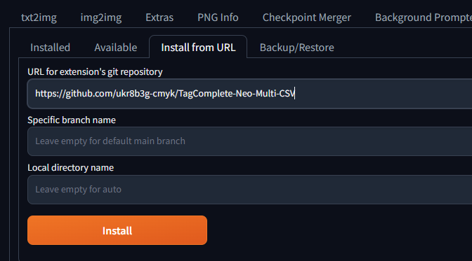
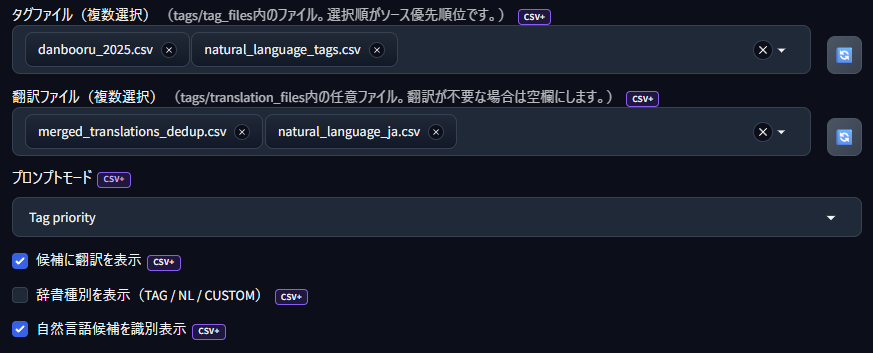
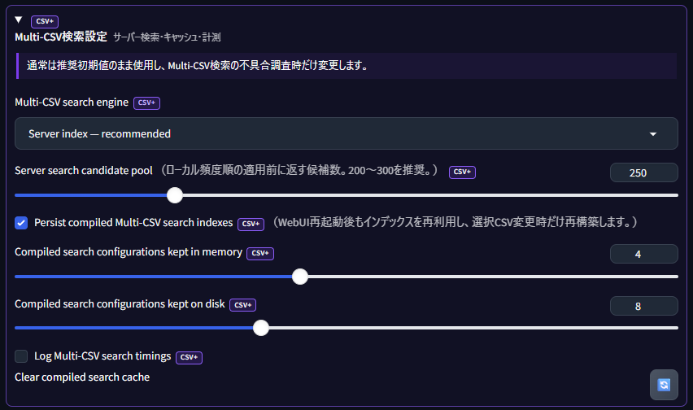
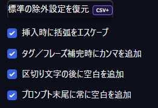
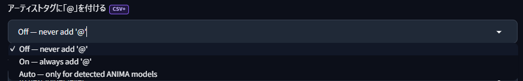
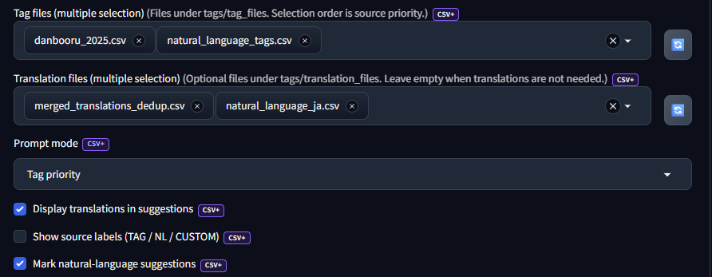
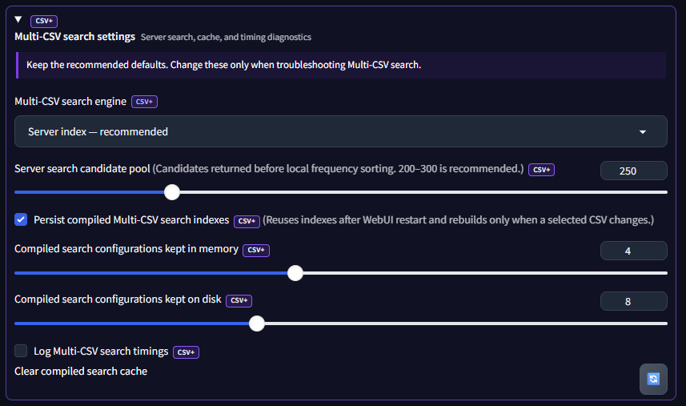
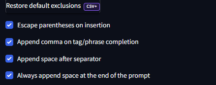
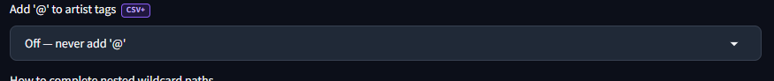

## 検索件数と初期辞書 / Match counts and default dictionary

候補一覧の上部に検索件数を固定表示します。例：temple：124件、件数制限時は124件中20件を表示。右端の投稿数とは別の情報です。旧検索APIで総数を得られない間は「取得○件（総数未取得）」と区別します。追加のON/OFF設定はなく、自動表示です。Python側の更新にはForgeの再起動が必要です。

The candidate header shows total matches and, when limited, the available subset. Per-tag post counts remain separate. Older search APIs are labelled as retrieved counts with the total unavailable. The header is automatic, with no new on/off setting. Restart Forge after updating the Python search API.

タグCSVの新規初期選択はtags_merged_dedup.csvのみです。追加辞書はJP Assistのタグファイル選択で指定できます。削除済みのdanbooru_tags.csv／danbooru_2025.csvが保存設定に残っている場合だけ統合CSVへ置換し、それ以外の選択・順序は維持します。

New tag selections default to tags_merged_dedup.csv only. Choose additional dictionaries in JP Assist's tag-file selector. Saved references to missing retired Danbooru files migrate to the merged CSV; other choices and their order remain intact.

<div align="center">

# TagComplete Neo Multi-CSV

**最新リリース: v1.2.0**

**[English](#english)**

## 複数のタグCSVを同時に読み込み・検索

**Load and search multiple tag CSV files at the same time**

Danbooru 2025、e621、自然言語、Anima、ユーザーCSVを、
モデルや用途に合わせて組み合わせられます。

**Forge Neo向け、reForge互換経路を維持した複数CSV・翻訳検索・自然言語辞書対応のタグ補完拡張**

A Forge Neo and reForge compatible fork of TagComplete Neo with multiple CSV sources,
separate translation files, Japanese/translated search, natural-language
vocabularies, a retained preset backend, and safe prompt insertion. Preset
controls are intentionally hidden in the current release.

</div>

> [!IMPORTANT]
> **最新版はGitHubリポジトリからのインストールを推奨します。**<br>
> Civitaiで配布しているZIPは公開時点のスナップショットであり、最新版より古い場合があります。<br>
> Forge Neo／reForgeの`Extensions` → `Install from URL`で、次のURLを使用してください。<br>
> `https://github.com/ukr8b3g-cmyk/TagComplete-Neo-Multi-CSV`
>
> **For the latest version, install directly from the GitHub repository.**<br>
> The ZIP distributed on Civitai is a release snapshot and may be older than the current GitHub version.

### リリースと旧バージョン

- **最新版:** [v1.2.0](https://github.com/ukr8b3g-cmyk/TagComplete-Neo-Multi-CSV/releases/tag/v1.2.0)
- **v1.2.0 ZIPを直接ダウンロード:** [TagComplete-Neo-Multi-CSV v1.2.0.zip](https://github.com/ukr8b3g-cmyk/TagComplete-Neo-Multi-CSV/archive/refs/tags/v1.2.0.zip)
- **旧バージョン:** [v1.1.0](https://github.com/ukr8b3g-cmyk/TagComplete-Neo-Multi-CSV/releases/tag/v1.1.0)

`Code` → `Download ZIP`と`Install from URL`は、v1.2.0以降の修正を含む最新mainを取得します。
上記のRelease ZIPはv1.2.0固定で、今回の①〜⑦は含みません。

### What's New

#### 2026-10-31：入力保護・重複処理・Undo・検索件数の改善

今回の①〜⑦は**最新のmainに含まれる修正**です。固定されたv1.2.0 Release ZIPには含まれません。

1. **日本語IMEの誤確定を防止**：変換中のEnter／Tab／矢印を補完が消費せず、変換開始時の古い候補と検索を無効化。変換確定キーを補完確定に二重使用しません。
2. **Cleaning OFF後の古い警告を防止**：OFFやSettingsのApplyで進行中の照会とキャッシュを無効化。遅れた成功・失敗応答で警告やキャッシュを復活させません。
3. **初回ロードとCleaning照会を共有**：同じ設定の読み込み途中に入力してもロードを共有。同じ候補への進行中照会も共有し、Cleaningは段階描画した候補から調べ、スクロール時に追加取得します。
4. **動的入力欄の監視を修正**：Textノードでの例外と同じaccordionへの重複登録を防止。複数の入力セレクター、入れ子の追加・削除・再挿入を扱います。
5. **サーバー検索でも最大候補数を適用**：通常タグ・自然言語・追加CSV候補を順位付けした後で表示上限を適用。使用頻度による順位と正確な総件数、LoRA／Embedding／Wildcard等の専用候補は維持します。
6. **重み変更を標準Undo／Redoに対応**：対象範囲だけをネイティブ編集し、フォーカス・選択・スクロールを保持。inputの二重通知を避け、ブラウザーの編集履歴で戻せるようにしました。
7. **正確な検索件数の集計を軽量化**：完全な候補集合が得られる場合はその範囲で集計。同じ検索語と別名／翻訳設定の件数を、常駐索引ごとに最大128件メモリーで再利用します。辞書変更・索引の切替／破棄・キャッシュ消去で古い件数を切り離し、ディスクへは保存しません。検索順と正確な総件数は変更しません。

**使い方・設定**

- 新しいON/OFF設定はありません。IMEの変換を確定してから、次の独立したEnter／Tabで候補を選択します。
- **Settings → Tag Autocomplete / Multi-CSV → 最大候補数（Maximum results）**を20にし、**すべての候補を表示（Show all results）**をOFFにすると通常候補を最大20件に制限します。ONなら表示側の切り詰めを解除しますが、サーバーの取得pool上限とは別です。総ヒット件数は表示件数とは独立して正確に表示します。
- **Danbooruタグの補正傾向を表示（Enable Danbooru Tag Cleaning Assist）**は従来どおり初期OFF。利用する場合だけONにします。タグの自動削除・置換は行いません。OFF／Apply時は古い照会を破棄します。
- 重みは通常タグ内にカーソルを置くか範囲選択して、**Ctrl＋↑／↓は0.05、Ctrl＋ホイールは0.10刻み**で変更します。**Ctrl＋ZでUndo、Ctrl＋Shift＋ZでRedo**。特殊構文やIME変換中には適用しません。ネイティブ編集に対応しない場合は文字列を直接書き換えず、変更を行いません。
- 件数集計の軽量化は自動で働きます。短い検索語の初回全件集計と初回索引構築は残ります。既存の検索時間ログではAPIの`count_ms`で集計部分を区別できます。

**反映方法**：ワークフローやプロンプトを保存し、利用者のタイミングでForgeを次回起動してブラウザーを再読み込みしてください。①〜⑥のJSは画面の再読み込み、⑦のPythonはForgeの次回起動で有効です。ブラウザーの更新だけでは起動中Pythonは置き換わりません。更新作業で自動の再起動・再読み込みは行いません。保存済み設定・CSV選択順・辞書・ワークフロー形式・追加依存は変更しません。

**検証と範囲**：WindowsのローカルPython156成功・1スキップ・119サブテスト成功、JS13スクリプト成功。①②は分離Chrome14項目、⑥は実際のネイティブUndo／Redoなど分離Chrome8項目で確認しました。実Forge／Gradio画面・OS日本語IME・実Queue内容の受入確認とは別です。旧新応答1,728条件と実辞書447,632行の8検索で候補順・件数が一致。CPU上の集計部分はtemple約111→0.04ms、blue約113→1.31msでした（各3回の中央値、索引構築・順位付け・画面描画を除く）。短語初回の全件走査は残り、キー入力から表示までの時間を保証する測定ではありません。

- プロンプト内の通常タグで`Ctrl + ↑ / ↓`は`0.05`、`Ctrl + Wheel`は`0.10`単位でweightを変更できます。
- 選択範囲、またはcaret位置のカンマ区切りタグが対象です。`1.00`では通常タグへ戻り、変更範囲は`-20.00`〜`10.00`です。
- LoRA、LyCORIS、Embedding、Wildcard、Dynamic Prompt、`$...`構文、角括弧、IME入力中は変更しません。
- この機能は現在の`main`で利用できます。タグ付きv1.2.0 Release ZIPは固定されており、この追加変更を含みません。

> このプロジェクトは `sd-webui-tagcomplete-neo` を基盤としたフォークです。<br>
> 候補ポップアップ、キーボード操作、カテゴリ色、LoRA・Embedding・Wildcard・Chantなど、
> TagComplete Neoの操作感を維持しながら、Danbooru Tag JP Assistの辞書管理方式を統合しています。

### プロジェクトの系譜

```text
DominikDoom/a1111-sd-webui-tagcomplete
  └─ eduardoabreu81/sd-webui-tagcomplete-neo
       └─ ukr8b3g-cmyk/TagComplete-Neo-Multi-CSV
```

- **原点:** `a1111-sd-webui-tagcomplete` — TagCompleteの基本機能
- **直接のフォーク元:** `sd-webui-tagcomplete-neo` — Forge Neo対応、互換性・性能改善
- **このフォーク:** 複数タグCSV、分離翻訳CSV、自然言語辞書、
  サーバー検索、永続キャッシュ、プリセットバックエンドを追加

元プロジェクトの機能と成果を尊重しつつ、本READMEはMulti-CSV版の実際の構成・
設定・検証結果に合わせて独自に記述しています。

---

## 日本語

### 対応環境

- Stable Diffusion WebUI Forge Neo
- Stable Diffusion WebUI reForge（互換経路あり、現行mainの実機再検証待ち）
- Gradio 3系・4系で異なる主要DOM構造を考慮

Forge Neoは既存の実機検証範囲があります。reForge向け互換経路は維持していますが、
現行mainでのreForge実機再検証は未実施です。
通常のStable Diffusion WebUI Forgeは未確認のため、対応環境には含めていません。

主な用途:

- SDXL、Illustrious XL、Ponyなどのタグ中心モデル
- Animaなどのタグ・自然言語ハイブリッドモデル
- Krea 2、Z-Image、FLUX、Qwen-Imageなどの自然言語中心モデル

モデルごとに辞書を強制固定しません。CSV・モード・挿入形式はユーザーが変更できます。

### 主な機能

#### TagComplete Neoから維持する機能

- 入力中の候補ポップアップ
- 矢印キー、Tab、Enter、Escapeによる操作
- Danbooru / e621カテゴリ色と投稿数表示
- Alias・翻訳検索
- 使用頻度による候補順位調整
- 高速インデックス検索
- LoRA / LyCORIS / Embedding補完
- Extra Networkサムネイル
- LoRAトリガーワード挿入とCivitAI照会
- Dynamic Prompts形式のWildcard補完
- YAML Wildcard / UMI対応
- Chant補完
- モバイル向け入力負荷軽減

#### Multi-CSV版で追加した機能

- タグCSVと翻訳CSVを別フォルダで管理
- タグCSVを複数選択
- 翻訳CSVを複数選択
- Danbooru、自然言語、ユーザー辞書の同時利用
- 同一タグ、Alias、翻訳の統合
- 日本語・他言語翻訳による検索
- 日本語・翻訳表示のON/OFF
- `Tag` / `Hybrid` / `Natural Language` / `Custom`モード
- アンダースコア保護パターンのワイルドカード指定
- 大容量CSV向けサーバー検索とv8永続キャッシュ
- 投稿数優先の候補並び替え（`count=0`も有効値として表示）
- プリセットバックエンドと既存保存データを維持（操作UIは非表示）
- Animaアーティストタグへの`@`付与設定
- 設定項目の日本語・英語マウスオーバーヘルプ
- 任意で有効化できるDanbooru Tag Cleaning Assist

### Danbooru Tag Cleaning Assist（v1.2.0）

Forge / Forge Neo向けの任意機能です。通常のTagComplete候補を変更せず、
公開データセット`Grio43/Tag_cleaning`の補正傾向を候補へ追加表示します。

- 既定値は`OFF`
- remove比率が高い候補へ`⚠ correction`を表示
- 十分なsupportとconfidenceがある共起タグを`Related adds`として表示
- タグを自動置換・削除せず、候補順位と挿入テキストも変更しない
- 明示的な更新操作でローカルSQLite DBをダウンロード・構築
- 通常補完では表示中のDanbooru候補だけをバッチ照会し、結果をキャッシュ
- `OFF`時はCleaning lookupを呼び出さず、従来のAutocomplete経路を維持

設定とデータの意味、DB構築手順については
[TAG_CLEANING.md](TAG_CLEANING.md)を参照してください。

### インストール

#### WebUIからインストール（推奨）

Forge NeoまたはreForgeの`Extensions` → `Install from URL`を開きます。



1. `URL for extension's git repository`へ次のURLを入力します。

   ```text
   https://github.com/ukr8b3g-cmyk/TagComplete-Neo-Multi-CSV
   ```

2. `Specific branch name`と`Local directory name`は空欄のままにします。
3. `Install`を押し、完了後にForge NeoまたはreForgeを再起動します。

#### Git clone

Forge NeoまたはreForgeの`extensions`フォルダーで実行します。

```powershell
cd "＜Forge-NeoまたはreForgeのインストール先＞\extensions"
git clone https://github.com/ukr8b3g-cmyk/TagComplete-Neo-Multi-CSV.git
```

#### ZIP

1. GitHubの`Code` → `Download ZIP`からZIPを取得して展開します。
2. 展開後のフォルダーをForge NeoまたはreForgeの`extensions`へ配置し、
   フォルダー名を`TagComplete-Neo-Multi-CSV`にします。

```text
Forge-Neo-or-reForge/
└─ extensions/
   └─ TagComplete-Neo-Multi-CSV/
      ├─ javascript/
      ├─ scripts/
      ├─ tags/
      └─ README.md
```

既に同名フォルダーがある場合は、上書きせず既存内容を確認してください。

#### 起動後

1. Forge NeoまたはreForgeを起動または再起動します。
2. Generate欄付近の状態ランプがオレンジから緑へ変わるまで待ちます。
3. `Settings` → `Tag Autocomplete / Multi-CSV`を開きます。
4. 設定変更後は`Apply settings`を押します。
   `requires Reload UI`と表示される項目だけUI再読み込みが必要です。

既存のTagComplete系拡張と同時に有効化すると、同じ入力欄へ複数の補完処理が登録される場合があります。
動作確認時は、他のTagComplete系拡張を一時的に無効化してください。

### 設定画面



主に変更する項目:

- **タグファイル（複数選択）:** 候補の本体となるタグ・自然言語CSV
- **翻訳ファイル（複数選択）:** 翻訳・別名を追加する任意CSV
- **プロンプトモード:** タグ優先、Hybrid、自然言語優先、同順位
- **候補に翻訳を表示:** 翻訳CSVの表示をON/OFF
- **辞書種別を表示:** `TAG` / `NL` / `CUSTOM`ラベルを任意表示
- **自然言語候補を識別表示:** 自然言語辞書の候補を見分けやすく表示
- **更新ボタン:** 対応するファイル一覧だけを再読込

各設定項目へマウスを合わせると、選択中の表示言語に応じた簡単な説明が表示されます。

通常利用では、最初の設定ブロックだけを確認すれば十分です。
最下部の`Multi-CSV検索設定`は、キャッシュ破損や性能調査時を除き推奨初期値のまま使用してください。

### データフォルダ

タグCSVと翻訳CSVは次のフォルダーへ同梱されます。ユーザーCSVも追加でき、
設定欄横の更新ボタンまたはWebUI再起動で一覧を更新できます。

```text
tags/
├─ tag_files/          # タグ・自然言語CSV
├─ translation_files/  # 翻訳・別名CSV
├─ chants/             # Chant JSON
├─ config/             # 内部設定、ユーザープリセット
├─ cache/              # 実行時キャッシュ
└─ temp/               # LoRA、Embedding、Wildcard等の一時一覧
```

CSVはサブフォルダにも配置できます。設定画面には相対パスで表示されます。

### 同梱データ

タグCSVと翻訳CSVは別フォルダで管理され、それぞれ複数選択できます。

#### タグCSV

| ファイル | 内容 | 主な用途 | 新規環境の初期選択 |
|---|---|---|---|
| `tags_merged_dedup.csv` | 重複除去済みDanbooru / e621統合辞書 | 汎用タグ補完（推奨） | ✓ |
| `natural_language_tags.csv` | 自然言語辞書 | Hybrid・自然言語入力（必要時に追加選択） | — |
| `e621.csv` | e621タグ辞書 | Furry・Anthro系 | — |
| `anima_artists.csv` | Animaアーティスト辞書 | Animaアーティスト補完 | — |
| `anima_characters.csv` | Animaキャラクター辞書 | Animaキャラクター補完 | — |

#### 翻訳CSV

| ファイル | 内容 | 主な用途 | 新規環境の初期選択 |
|---|---|---|---|
| `merged_translations_dedup.csv` | タグ翻訳・別名 | 日本語検索・候補表示 | ✓ |
| `natural_language_ja.csv` | 自然言語の日本語翻訳 | 日本語での自然言語検索 | ✓ |

> 初期選択は新規インストール時の値です。既存の設定やユーザープリセットは
> 維持されるため、アップデート後の選択内容とは異なる場合があります。
> Animaを使用する場合は、必要に応じて`anima_artists.csv`と
> `anima_characters.csv`を追加選択してください。

既定の`tags_merged_dedup.csv`は、
[sd-webui-tagcomplete-neo](https://github.com/eduardoabreu81/sd-webui-tagcomplete-neo)
由来のDanbooru / e621を重複除去して統合した辞書です。
旧`danbooru_2025.csv`は同梱していません。個別の`e621.csv`は引き続き選択できます。

> [!IMPORTANT]
> **`tags_merged_dedup.csv`は、`e621.csv`などの統合元CSVと同時に選択しないでください。**
> 重複データによりインデックス構築時間とメモリ使用量が増え、カテゴリ・件数・
> ソース優先順位も分かりにくくなります。統合辞書か個別CSVの組み合わせの、
> どちらか一方を使用してください。

### タグCSV

推奨ヘッダー:

```csv
tag,category,count,aliases,translation,source_type,insert_mode,category_scheme
long_hair,0,3608339,"longhair","長髪",tag,tag,danbooru
soft natural lighting,,100,"soft light","柔らかな自然光",natural_language,phrase,natural_language
with,,50,,,natural_language,word,natural_language
special_identifier_name,,1,,,custom,raw,custom
```

必須列は`tag`だけです。

対応する主な列:

- `tag`: 候補名・挿入テキスト
- `category`: Danbooru / e621互換カテゴリ番号
- `count`: 投稿数または優先度
- `aliases`: 検索用別名。カンマまたはセミコロン区切り
- `translation`: 表示・検索用翻訳
- `source_type`: `tag` / `natural_language` / `custom`
- `insert_mode`: `tag` / `phrase` / `word` / `raw` / `wildcard`
- `category_scheme`: `danbooru` / `e621` / `derpibooru` / `danbooru_e621_merged`など

従来のTagComplete形式も読み込めます。

```csv
long_hair,0,3608339,"longhair"
```

ヘッダーや種別列がない場合、ファイル名から可能な範囲で推定します。
`EnglishDictionary.csv`、`natural_language`、`krea`、`flux`、`qwen`などを含む名前は
自然言語辞書として扱われます。

### 翻訳CSV

推奨形式:

```csv
tag,ja,aliases
long_hair,"長髪,ロングヘア","髪が長い"
blue_eyes,"青い目,碧眼","ブルーアイ"
```

汎用形式も利用できます。

```csv
tag,translation,aliases
long_hair,"long hair","flowing hair"
```

従来の2列形式も利用できます。

```csv
long_hair,長髪
```

翻訳CSVを選択しなければ、翻訳機能なしで通常のTagCompleteとして動作します。
日本語専用の固定処理ではないため、他言語の翻訳CSVも利用できます。

### 複数CSVとサーバー検索



`Tag files`と`Translation files`は複数選択ドロップダウンです。

例:

```text
Tag files:
- tags_merged_dedup.csv
- natural_language_tags.csv
- e621.csv
- my_custom_tags.csv

Translation files:
- merged_translations_dedup.csv
- natural_language_ja.csv
```

統合時の動作:

- 同じタグは候補に1件だけ表示
- Aliasと翻訳は重複を除いて統合
- `count`は最大値を採用
- 有効なカテゴリ情報を維持
- 読み込み元ファイルと辞書種別を内部保持
- 選択順をソース優先順として扱う

これは候補データの重複統合です。入力済みプロンプト本文を自動削除・整形する機能ではありません。

推奨の`Server index`では、統合済み全データをブラウザへ送らず、
Python側に保持して現在の検索に必要な候補だけを返します。

- 起動後のアイドル時間に、選択中CSV構成のv8検索インデックスを構築または復元
- 同じセッションではメモリキャッシュを利用
- Forge Neo再起動後はディスクキャッシュから復元
- 選択CSVのファイル名・サイズ・更新日時が変わると自動再構築
- キャッシュは`tags/cache/fast-search-v8/`へ保存
- ブラウザへ返す候補数は`Server search candidate pool`で制限（同投稿数の使用頻度調整は返却範囲内で行う）

大きなCSVを増やすほど、初回構築時間とPython側のメモリ使用量は増えます。
一方、Server indexではブラウザへ全CSVを転送しないため、クライアント負荷は候補プール内に抑えられます。
通常は用途に必要な辞書だけを選択してください。

性能設計と実機計測の詳細は[PERFORMANCE.md](PERFORMANCE.md)を参照してください。

### 候補の並び順

新規インストール時の`Candidate sort mode`は`投稿数優先`です。通常タグでは、
ソース優先順位の後に投稿数を降順で並べ、同じ投稿数では一致度、CSV順で決定します。
`count=0`は有効な投稿数として表示・並び替えの対象になります。自然言語・Custom候補は
投稿数順の対象外で、一致度順です。

### プロンプトモード

#### Tag priority

Danbooruなどのタグ辞書を優先します。SDXL、Illustrious XL、Pony系などに向く初期設定です。

#### Auto (Hybrid)

タグ辞書と自然言語辞書を同時利用します。カンマ区切りのタグ入力ではタグを、
文章状の入力では自然言語候補をやや優先します。Animaなどを想定しています。

#### Natural language priority

自然言語辞書を優先します。Krea 2、Z-Image、FLUX、Qwen-Imageなどを想定しています。

#### Equal priority

選択CSVと設定をそのまま使用します。

モードは検索順位と挿入規則を調整します。CSV選択を強制的に固定するものではありません。

### 表示言語

`表示言語`を`日本語`にすると、Multi-CSV追加項目だけでなくTagComplete Neo標準設定の
項目名も日本語で表示します。`Auto`ではForge NeoのLocalization設定またはブラウザー言語に
合わせます。設定値やJSON内のキーは翻訳せず、互換性を維持します。

### ユーザープリセット

プリセットバックエンド、保存形式、API、既存のユーザープリセットデータは互換性のため維持されています。
ただし、ユーザープリセット操作UIは現行リリースで意図的に非表示です。
今回の整合作業ではプリセット操作UIを有効化していません。

### 検索

- 英語タグ
- 英語Alias
- 日本語・他言語翻訳
- 翻訳Alias
- 自然言語の単語・フレーズ
- ユーザー辞書

検索順位:

1. 完全一致
2. 前方一致
3. 単語先頭一致
4. 部分一致

検索時は`_`と空白を同一視します。日本語・翻訳検索と翻訳表示は別々に切り替えられます。
そのため、日本語で検索しつつ候補表示を英語だけにすることも可能です。

### 候補表示

初期表示はTagComplete Neoを踏襲します。

- カテゴリ色
- 投稿数
- Alias / 翻訳
- 使用頻度マーカー
- 既出タグマーカー
- Extra Networkプレビュー

追加表示は任意です。

- `Show source labels`: `TAG` / `NL` / `CUSTOM`
- `Mark natural-language suggestions`
- `Display translations in suggestions`

ソースラベルは初期値OFF、自然言語識別と翻訳表示は初期値ONです。

### 挿入形式



設定可能な項目:

- アンダースコアを空白へ変換
- カンマを追加
- 区切り後にスペースを追加
- 文末にスペースを追加
- 括弧をエスケープ
- アンダースコア変換除外パターン

推奨初期値では通常タグを次のように挿入します。

```text
long hair, blue eyes, looking at viewer,
```

実際の初期設定では末尾にスペースも追加されます。

`insert_mode`の動作:

- `tag`: カンマ＋スペース
- `phrase`: カンマ＋スペース
- `word`: スペースのみ
- `raw`: 文字列を変換せず挿入
- `wildcard`: Wildcard構文を完全保持

自然言語CSVに`insert_mode`がない場合、単語1個は`word`、複数語は`phrase`として推定します。

### Animaアーティストタグの`@`付与



`アーティストタグに「@」を付ける`は、アーティスト候補を挿入する際の接頭辞を制御します。

- **Off:** `@`を付けない。初期値
- **On:** 対象アーティストタグへ常に`@`を付ける
- **Auto:** 読み込まれているモデルがANIMA系と判定された場合だけ`@`を付ける

Anima以外のモデルや、モデル判定に依存させたくない場合は`Off`または`On`を明示してください。

### アンダースコア保護

除外欄はカンマ区切り・改行区切りに対応し、`*`と`?`を使えます。

初期値には次のような構文依存タグを含みます。

```text
score_*
^_^
>_<
@_@
=_=
o_o
x_x
u_u
|_|
||_||
0_0
3_3
6_9
._.
+_+
+_-
(o)_(o)
<o>_<o>
```

例:

```text
score_8_up  -> score_8_up
long_hair   -> long hair
```

旧式のDanbooru表記をすべて保護するのではなく、構文上アンダースコアが必要な項目だけを保護します。

### Dynamic Prompts / Wildcard

次のような構文は常にそのまま扱います。

```text
__wildcards/eye-color__
```

- 前後の`__`を維持
- 内部の`/`、`-`、`_`を維持
- 通常タグのアンダースコア変換を適用しない
- 通常タグ用のカンマを自動追加しない

Wildcard ManagerやDynamic Promptsの既存ファイル構成を変更しません。

### 詳細設定／トラブルシューティング

設定ページ最下部に、通常は変更しない項目を2つのアコーディオンへ分けています。
どちらも初期状態は閉じています。通常利用では初期値のままにしてください。

`TagComplete Neoインターフェース設定（CORE）`:

- `Configure Hotkeys`: 候補操作キーをJSONで変更
- `Configure colors`: Danbooru／e621カテゴリ色をJSONで変更
- `Refresh internal temp files`: WildcardやEmbeddingなどの内部一覧を再作成

`Multi-CSV検索設定（CSV+）`の推奨値:

| 項目 | 推奨値 | 用途 |
|---|---:|---|
| `Multi-CSV search engine` | `Server index` | サーバー側インデックス検索 |
| `Server search candidate pool` | `250` | ローカル頻度順位へ渡す候補数 |
| `Persist compiled Multi-CSV search indexes` | ON | 再起動後にディスクキャッシュを再利用 |
| `Compiled search configurations kept in memory` | `4` | セッション内のCSV構成保持数 |
| `Compiled search configurations kept on disk` | `8` | ディスク上のCSV構成保持数 |
| `Log Multi-CSV search timings` | OFF | 性能調査時だけ有効化 |

`Clear compiled search cache`は、キャッシュ破損やCSV更新が反映されない場合だけ実行してください。
通常はCSV変更を自動検出するため、手動削除は不要です。

`Extra filename`と`Chant filename`の右横にある更新ボタンは、それぞれCSV一覧と
Chant JSON一覧だけを再読込します。Forge Neo全体をリロードするボタンではありません。

ホットキーと候補色は有効なJSONである必要があります。不具合の原因を切り分ける場合を除き、
既定値を変更しないことを推奨します。

### 対象外

この拡張は候補の検索・表示・挿入に集中します。次は実装していません。

- プロンプト全体の自動整形
- 入力済みタグの自動重複削除
- クリップボード内容の自動整形
- ペースト時の自動変換
- Booru Structure処理
- JSONプロンプト生成
- TagComplete UIと別の第二候補UI

### オフライン検証

展開した拡張フォルダで次を実行すると、Python構文、JavaScript構文、
辞書統合、プリセット、Wildcard保護などをまとめて確認できます。

```bash
python tools/verify_extension.py
```

これはForge Neo本体を起動しない検証です。最終確認ではForge Neoの実環境で、
CSV選択、候補表示、LoRA・Embedding・Wildcard補完、設定保存を確認してください。

### トラブルシューティング

#### CSVを追加しても表示されない

- 設定欄横の更新ボタンを押す
- `Apply settings`を押す
- 必要に応じて`Reload UI`
- CSVが`tags/tag_files`または`tags/translation_files`にあることを確認

#### 候補が二重に表示される

他のTagComplete系拡張が同時に有効になっていないか確認してください。

#### 補完が出ない

- `Enable Tag Autocompletion`を確認
- 対象タブの`Active in ...`を確認
- Tag filesが1件以上選択されているか確認
- ブラウザ開発者コンソールとWebUIコンソールを確認

#### 自然言語に不要なカンマが付く

辞書の対象行に`insert_mode=word`または`insert_mode=raw`を指定してください。

#### 特殊タグのアンダースコアが消える

`Underscore replacement exclusion patterns`へ完全名またはパターンを追加してください。

#### 起動直後または最初の検索だけ時間がかかる

起動後のアイドル時間に選択中CSVのインデックス構築、または再起動後の
ディスクキャッシュ復元が発生します。入力が早い場合は最初の検索が同じ処理へ合流します。
同じセッションの2回目以降はメモリキャッシュを利用します。
継続的に遅い場合だけ`Log Multi-CSV search timings`を有効にして確認してください。

---

## English

### Releases and previous versions

- **Latest:** [v1.2.0](https://github.com/ukr8b3g-cmyk/TagComplete-Neo-Multi-CSV/releases/tag/v1.2.0)
- **Direct v1.2.0 ZIP download:** [TagComplete-Neo-Multi-CSV v1.2.0.zip](https://github.com/ukr8b3g-cmyk/TagComplete-Neo-Multi-CSV/archive/refs/tags/v1.2.0.zip)
- **Previous:** [v1.1.0](https://github.com/ukr8b3g-cmyk/TagComplete-Neo-Multi-CSV/releases/tag/v1.1.0)

`Code` → `Download ZIP` and `Install from URL` provide current main, including fixes made after v1.2.0.
The direct Release ZIP remains fixed to v1.2.0 and does not include fixes 1–7 above.

### What's New

#### 2026-10-31: input safety, shared work, Undo and exact match counting

Fixes 1–7 are included in **current main**, not the fixed v1.2.0 Release ZIP.

1. **Protect IME composition:** do not consume Enter/Tab/arrows during composition; invalidate old suggestions and searches at composition start and avoid using the confirmation key twice.
2. **Reject stale Cleaning responses:** turning Cleaning OFF or applying Settings invalidates requests and cache. Late successes and failures cannot restore old annotations or cache entries.
3. **Share loading and lookup work:** typing during the same configuration's load waits for that load. Pending Cleaning lookups are shared; only rendered candidates are queried, with later rows loaded during scrolling.
4. **Fix dynamic textarea observation:** ignore Text nodes, share one observer per accordion while retaining all selectors, and handle nested insertion, removal and reinsertion.
5. **Apply the final candidate cap in server search:** limit normal tags, natural-language and extra CSV candidates after ranking. Preserve usage ranking, exact total matches and dedicated LoRA/Embedding/Wildcard lists.
6. **Support native weight Undo/Redo:** edit only the target range through native input, retaining focus, selection and scroll without duplicate input notifications.
7. **Count matches without unnecessary full scans:** count within complete indexed candidate sets and reuse exact counts for the normalized query and alias/translation switches. Each resident index keeps at most 128 memory-only counts. Changed/discarded indexes and cache clearing detach old counts; ranking and exact totals remain unchanged.

**How to use**

- No new switches. Finish IME composition, then use a separate Enter/Tab to choose a suggestion.
- In **Settings → Tag Autocomplete / Multi-CSV**, set **Maximum results** to 20 and turn **Show all results** OFF to cap normal candidates at 20. ON removes this display cap; the server retrieval pool still has its own limit. Exact total matches remain independent of the displayed subset.
- **Enable Danbooru Tag Cleaning Assist** remains OFF by default. Enable it only when wanted; it provides hints without automatically deleting or replacing tags. OFF/Apply invalidates old lookups.
- With the caret inside a normal tag, or a tag selected, use **Ctrl+Up/Down for 0.05 steps** and **Ctrl+Wheel for 0.10 steps**. Use **Ctrl+Z to Undo** and **Ctrl+Shift+Z to Redo**. Special syntax and active IME composition remain protected. Unsupported native editing leaves the text unchanged instead of falling back to direct assignment.
- Count optimization is automatic. Initial index construction and first full counts for short queries remain. The API's `count_ms` separates counting from the existing search timing fields.

**Activate safely:** save prompts/workflows, then restart Forge and reload the browser at your own chosen time. Fixes 1–6 are JavaScript and activate after a page reload; fix 7 is Python and needs the next Forge start. A browser reload alone cannot replace running Python code. Updates do not restart or reload automatically. Saved settings, CSV order, dictionary bytes, workflow format and dependencies remain intact.

**Validation and limits:** local Windows tests passed 156 Python tests, skipped one platform-specific case, and passed 119 subtests and 13 JS scripts. Isolated Chrome covered 14 IME/Cleaning cases and eight native weight-edit/Undo cases; this is separate from live Forge/Gradio, native OS IME and real Queue acceptance. Old/new responses matched across 1,728 combinations and eight searches over 447,632 real dictionary rows. CPU count-only medians changed from about 111 to 0.04 ms for temple and 113 to 1.31 ms for blue (three samples each; index preparation, ranking and rendering excluded). Initial short-query full scans remain; these are not keystroke-to-paint guarantees.

- Use `Ctrl + Up / Down` for `0.05` steps or `Ctrl + Wheel` for `0.10` steps on a normal prompt tag.
- The selected text, or the comma-delimited tag at the caret, is adjusted. A weight of `1.00` returns to plain text; the supported range is `-20.00` to `10.00`.
- LoRA, LyCORIS, Embedding, Wildcard, Dynamic Prompt, `$...` syntax, square brackets, and active IME composition are left unchanged.
- This feature is available on the current `main`. The tagged v1.2.0 Release ZIP is fixed and does not include this later change.

### Project lineage

```text
DominikDoom/a1111-sd-webui-tagcomplete
  └─ eduardoabreu81/sd-webui-tagcomplete-neo
       └─ ukr8b3g-cmyk/TagComplete-Neo-Multi-CSV
```

This repository is directly derived from `sd-webui-tagcomplete-neo`, which is
itself a Forge Neo fork of DominikDoom's original TagComplete extension. This
fork retains the established completion UI and providers while adding multiple
tag CSVs, separate translation CSVs, natural-language dictionaries,
server-side search, persistent caching, and a retained preset backend.

### Overview

TagComplete Neo Multi-CSV keeps the familiar autocomplete UI and existing
completion providers while adding a multi-source dictionary layer inspired by
Danbooru Tag JP Assist.

Key additions:

- Separate `tag_files` and `translation_files` directories
- Multi-select tag and translation CSV settings
- Deduplicated merging of tags, aliases, translations, counts, and categories
- Optional translated search and translated display
- Natural-language dictionaries and Tag / Hybrid / Natural Language modes
- Glob-style underscore exclusion patterns
- Server-side search with a persistent v8 cache
- Count-first candidate ordering, including visible `count=0` values
- Preset backend and stored user data retained; preset controls currently hidden
- Configurable `@` prefix for Anima artist tags
- Bilingual hover help for settings
- Optional Danbooru Tag Cleaning Assist

### Danbooru Tag Cleaning Assist (v1.2.0)

This optional Forge / Forge Neo feature annotates normal TagComplete candidates
with correction signals from the public `Grio43/Tag_cleaning` dataset.

- Disabled by default
- Shows `⚠ correction` for strongly remove-heavy correction data
- Shows qualifying co-occurring tags as `Related adds`
- Never rewrites or removes tags, changes candidate ranking, or changes insertion text
- Downloads and builds an extension-local SQLite database only on explicit update
- Looks up only the currently displayed Danbooru candidates and caches the results
- Makes no Cleaning lookup when disabled, preserving the existing autocomplete path

See [TAG_CLEANING.md](TAG_CLEANING.md) for semantics, settings, and database details.

### Installation

#### Install from the WebUI (recommended)

Open `Extensions` → `Install from URL` in Forge Neo or reForge.


1. Enter the following address in `URL for extension's git repository`:

   ```text
   https://github.com/ukr8b3g-cmyk/TagComplete-Neo-Multi-CSV
   ```

2. Leave `Specific branch name` and `Local directory name` empty.
3. Select `Install`, then restart Forge Neo or reForge when installation completes.

#### Git clone

Run the following command from the Forge Neo or reForge `extensions` directory:

```powershell
cd "<path-to-Forge-Neo-or-reForge>\extensions"
git clone https://github.com/ukr8b3g-cmyk/TagComplete-Neo-Multi-CSV.git
```

#### ZIP

1. Select `Code` → `Download ZIP` on GitHub and extract the archive.
2. Move the extracted folder into the Forge Neo or reForge `extensions` directory and
   name it `TagComplete-Neo-Multi-CSV`.

```text
Forge-Neo-or-reForge/
└─ extensions/
   └─ TagComplete-Neo-Multi-CSV/
```

Do not overwrite an existing folder without reviewing its contents first.

#### After installation

1. Start or restart Forge Neo or reForge.
2. Wait until the status indicator near Generate changes from orange to green.
3. Open:

```text
Settings -> Tag Autocomplete / Multi-CSV
```

4. After changing settings, select `Apply settings`. Reload the UI only for
   options explicitly marked `requires Reload UI`.

Disable other TagComplete forks while testing to avoid duplicate listeners.

### Settings overview



Controls used most often:

- **Tag files (multiple selection):** tag and natural-language CSV sources
- **Translation files (multiple selection):** optional translation and alias files
- **Prompt mode:** Tag priority, Hybrid, Natural Language priority, or Equal priority
- **Display translations in suggestions:** controls translated labels in the popup
- **Show source labels:** optionally displays `TAG` / `NL` / `CUSTOM`
- **Mark natural-language suggestions:** visually distinguishes natural-language rows
- **Refresh buttons:** reload only the corresponding file list

Hover over a setting to see a short explanation in the selected interface language.

Keep the advanced Multi-CSV search controls at their recommended defaults
unless diagnosing cache or performance problems.

### Data layout

Tag and translation CSV files are stored separately and support multiple
selections.

#### Tag CSV files

| File | Contents | Best for | New-install default |
|---|---|---|---|
| `tags_merged_dedup.csv` | Deduplicated Danbooru / e621 merged dictionary | General tag completion (recommended) | ✓ |
| `natural_language_tags.csv` | Natural-language dictionary | Hybrid and natural-language input (optional selection) | — |
| `e621.csv` | e621 tag dictionary | Furry / anthro models | — |
| `anima_artists.csv` | Anima artist dictionary | Anima artist completion | — |
| `anima_characters.csv` | Anima character dictionary | Anima character completion | — |

#### Translation CSV files

| File | Contents | Best for | New-install default |
|---|---|---|---|
| `merged_translations_dedup.csv` | Tag translations and aliases | Japanese search and suggestion display | ✓ |
| `natural_language_ja.csv` | Japanese natural-language translations | Japanese natural-language search | ✓ |

> Defaults shown above apply to new installations. Existing settings and user
> presets are preserved, so selections can differ after an update. For Anima,
> select `anima_artists.csv` and `anima_characters.csv` as needed.

The default `tags_merged_dedup.csv` combines Danbooru / e621 data derived from
[sd-webui-tagcomplete-neo](https://github.com/eduardoabreu81/sd-webui-tagcomplete-neo) after deduplication.
The retired `danbooru_2025.csv` is no longer bundled; the individual `e621.csv` remains available.

> [!IMPORTANT]
> **Do not select `tags_merged_dedup.csv` together with its source dictionaries,
> such as `e621.csv`.** Redundant data increases index build time and memory use and
> makes category, count, and source-priority resolution harder to understand.
> Use either the merged dictionary or the separate source files.

```text
tags/
├─ tag_files/
├─ translation_files/
├─ chants/
├─ config/
├─ cache/
└─ temp/
```

Subfolders are supported.

### Tag CSV

Recommended header:

```csv
tag,category,count,aliases,translation,source_type,insert_mode,category_scheme
```

Only `tag` is required. Headerless TagComplete-compatible CSV files remain
supported.

`source_type` values:

- `tag`
- `natural_language`
- `custom`

`insert_mode` values:

- `tag`: comma and space
- `phrase`: comma and space
- `word`: space only
- `raw`: preserve the text
- `wildcard`: preserve wildcard syntax

### Translation CSV

Recommended format:

```csv
tag,translation,aliases
long_hair,"long hair","flowing hair"
```

JP Assist format is also supported:

```csv
tag,ja,aliases
long_hair,"長髪,ロングヘア","髪が長い"
```

Translations are optional and not limited to Japanese.

### Multiple sources and server search



Merge rules:

- A tag is displayed once even if it appears in multiple files.
- Aliases and translations are unioned and deduplicated.
- The maximum valid count is retained.
- Booru category information is preserved.
- Source files and source types are retained internally.
- Selection order is treated as source priority.

With the recommended `Server index`, the complete merged dataset remains on
the Python side and the browser receives only a bounded candidate pool.

- Idle time after startup builds or restores a v8 index for the selected CSV combination.
- Later searches in the same session use the memory cache.
- After a Forge Neo restart, the index is restored from disk.
- File name, size, or modification-time changes automatically invalidate the cache.
- Compiled data is stored under `tags/cache/fast-search-v8/`.
- `Server search candidate pool` controls how many candidates are returned before client-side final ordering; usage-based tie-breaking is limited to that returned pool.

Selecting more large files increases initial build time and Python memory use,
but it does not require transferring the full merged dataset to the browser.
See [PERFORMANCE.md](PERFORMANCE.md) for architecture and measured reference results.

### Candidate ordering

New installations use `Count first` as the candidate sort mode. For normal tag
candidates, source priority is followed by descending post count, then match
quality and CSV order. `count=0` is a valid post count and is displayed.
Natural-language and custom candidates remain ranked by match quality rather
than post count.

### Prompt modes

- **Tag priority:** best for Danbooru-style SDXL, Illustrious, and Pony workflows.
- **Auto (Hybrid):** combines tag and natural-language dictionaries; intended for workflows such as Anima.
- **Natural language priority:** intended for Krea 2, Z-Image, FLUX, and Qwen-Image.
- **Equal priority:** uses the selected sources without an additional source preference.

Prompt mode changes ranking and insertion behavior; it does not force a fixed CSV selection.

### Interface language

Selecting `Japanese` translates the Multi-CSV controls and the standard
TagComplete Neo setting labels. `Auto` follows Forge Neo localization or the
browser language. Stored values and JSON keys remain unchanged for compatibility.

### User presets

The preset backend, storage format, API, and existing user preset data remain
available for compatibility. Preset controls are intentionally hidden in the
current release and were not enabled by this documentation alignment.

### Search and suggestions

Search covers tags, aliases, translations, translated aliases,
natural-language words and phrases, and custom dictionaries.

Ranking order:

1. Exact match
2. Prefix match
3. Word-prefix match
4. Substring match

Underscores and spaces are treated as equivalent while searching.
Translated search and translated display can be controlled separately.

Optional suggestion metadata includes:

- `TAG` / `NL` / `CUSTOM` source labels
- Natural-language row marking
- Translated display labels

### Prompt insertion



The default insertion settings:

- Replace underscores with spaces
- Escape parentheses
- Append a comma after tag or phrase completion
- Append a space after the separator
- Keep a trailing prompt space

`insert_mode` behavior:

- `tag`: comma and space
- `phrase`: comma and space
- `word`: space only
- `raw`: preserve the text
- `wildcard`: preserve wildcard syntax

When a natural-language CSV omits `insert_mode`, a single word is inferred as
`word` and a multi-word value as `phrase`.

### Anima artist `@` prefix



`Add '@' to artist tags` controls the prefix used when inserting artist suggestions.

- **Off:** never add `@`; default
- **On:** always add `@` to applicable artist tags
- **Auto:** add `@` only when the loaded checkpoint is detected as an ANIMA model

Use explicit `Off` or `On` when model detection should not control insertion.

### Wildcards and underscore protection

Dynamic Prompts syntax such as:

```text
__wildcards/eye-color__
```

is always preserved. Underscore exclusions accept comma/newline-separated glob
patterns such as `score_*`.

### Advanced settings / troubleshooting

Rarely used controls are grouped into two closed accordions at the bottom of the
settings page. Keep the defaults during normal use.

- `TagComplete Neo interface settings (CORE)` contains the hotkey JSON, suggestion
  color JSON, and the internal temporary-file refresh action.
- `Multi-CSV search settings (CSV+)` contains server search, candidate-pool,
  cache, timing-log, and compiled-cache controls.
- Recommended values are `Server index`, pool `250`, persistent cache enabled,
  four memory configurations, eight disk configurations, and timing logs disabled.
- `Clear compiled search cache` is intended only for damaged or stale cache diagnosis.
- The refresh buttons beside Extra filename and Chant filename only refresh
  their respective file lists; they do not reload Forge Neo.

### Offline verification

Run the packaged verification script from the extracted extension directory:

```bash
python tools/verify_extension.py
```

This validates Python/JavaScript syntax and the WebUI-independent merge, preset,
and wildcard-protection logic. A real WebUI installation is still required for
final UI and integration testing.

### Compatibility notes

Forge Neo has an existing real-installation validation record. The reForge
compatibility path remains in the implementation, but current-main revalidation
on reForge is pending. Standard Stable Diffusion WebUI Forge has not yet been
verified and is not listed as a supported environment. Runtime compatibility can
still depend on WebUI changes, other extensions, browser versions, and local
model directory settings.

---

## Credits

- [a1111-sd-webui-tagcomplete](https://github.com/DominikDoom/a1111-sd-webui-tagcomplete) by DominikDoom — original project
- [sd-webui-tagcomplete-neo](https://github.com/eduardoabreu81/sd-webui-tagcomplete-neo) by Eduardo Abreu — Forge Neo fork and performance/compatibility work
- [Danbooru-Tag-JP-Assist](https://github.com/ukr8b3g-cmyk/Danbooru-Tag-JP-Assist) by ukr8b3g-cmyk — multiple CSV, separated translations, translated search, and data-update design
- [sd-dynamic-prompts](https://github.com/adieyal/sd-dynamic-prompts) — supported wildcard syntax

## License

The software is distributed under the MIT License. See [LICENSE](LICENSE).
The original Dominik Reh copyright and permission notice are retained, and the
copyright notice for this fork's modifications is included.

CSV and translation data can have separate terms. See
[THIRD_PARTY_NOTICES.md](THIRD_PARTY_NOTICES.md), the source page for each data
file, and any notice distributed with user-provided files.
